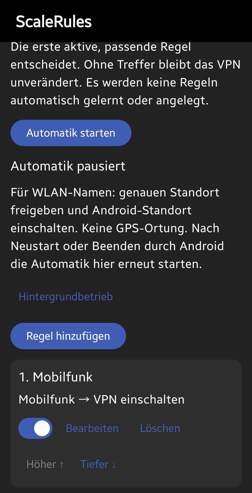
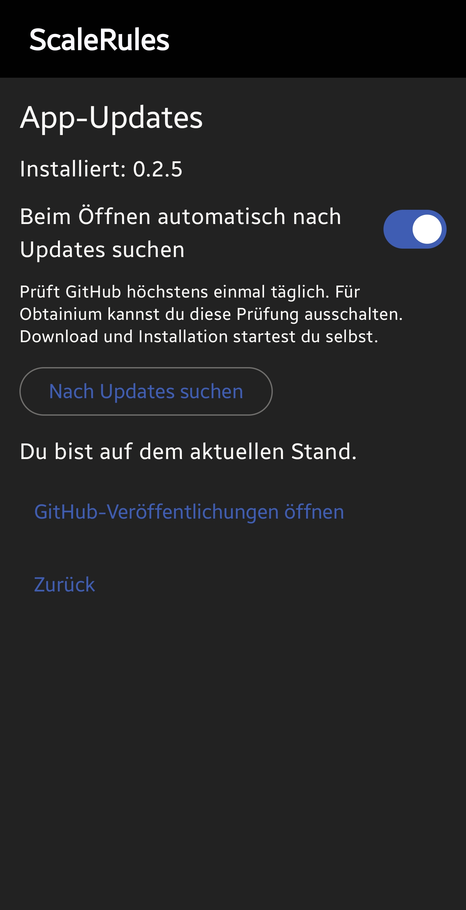
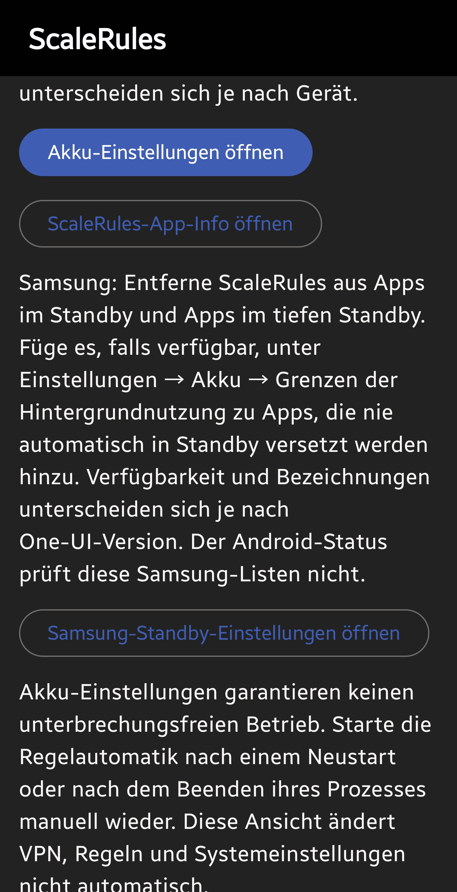

**This README is bilingual: [English](#english) first, followed by [Deutsch](#deutsch).**  
**Diese README ist zweisprachig: zuerst [Englisch](#english), darunter [Deutsch](#deutsch).**

  

# ScaleRules

  
  
  

Screenshots show the German interface; the language follows your Android settings. / Die Screenshots zeigen die deutsche Oberfläche; die Sprache folgt den Android-Einstellungen.

# English

ScaleRules is an independent Android VPN client for **Tailscale and Headscale**, with automatic connection rules that you define yourself.

Current stable release: **[0.2.8](https://github.com/teddybaerd/scalerules/releases/tag/v0.2.8)**.

Signed APKs are available from [GitHub Releases](https://github.com/teddybaerd/scalerules/releases). Distribution is through GitHub, the built-in updater or Obtainium. Publication on the Google Play Store is not planned.

## Features

### English and German

The app interface, connection rules and related notifications are available in **English and German**. The language follows your Android settings; Android 13 and later also let you select it through the system's per-app language settings.

Your rule names and Wi-Fi names remain unchanged. Existing journal entries retain their original language. Technical diagnostics supplied by the VPN engine may still appear in English.

### Connection rules with priorities

Under **Settings → Connection rules**, you define conditions and actions:

- Conditions: a specific Wi-Fi SSID, any Wi-Fi, mobile data, offline or any connected network.
- Actions: connect the VPN, disconnect it or leave its current state unchanged.
- The order determines priority: **the first enabled matching rule wins.**
- Without a matching rule, the VPN state stays unchanged.
- Warnings help identify conflicting rules and rules hidden by earlier rules.
- A decision journal records recent automation actions.

There is **no automatic learning feature**. Editing the rules pauses automation, which you must explicitly resume. The optional **Start rules after reboot** setting restores previously active automation after a device restart. Manually paused automation remains paused. App updates automatically resume previously active automation with the saved settings, independently of the reboot option. Current connection rules are evaluated again. After other process termination, manual resumption may still be necessary.

For SSID rules, Android requires precise location permission and enabled location services to provide the Wi-Fi name. An SSID alone does not establish that a Wi-Fi network is trustworthy.

Use **Use current Wi-Fi** in an SSID rule to copy the connected Wi-Fi name into the draft. Manual entry remains available; a failed lookup preserves existing input.

### Background operation and restart

A dismissible setup hint opens ScaleRules app info, where you can disable permission removal for unused apps and check unrestricted battery usage. The guidance remains available under **Settings → Background operation**, including Android battery optimization status and Samsung standby instructions.

To resume SSID rules after reboot, grant precise location and **Location → Allow all the time** in Android app permissions, enable **Start rules after reboot**, and start automation once. Without the required background location or VPN permission, a notification opens the rules screen for manual resumption. Notifications must be allowed. Normal boot handling may wait until unlock; force-stop and manufacturer battery restrictions can prevent startup. The VPN follows the current rules, so it can remain disconnected on your home Wi-Fi.

Autostart was tested on Samsung Galaxy S10 and Tab S8; the manual-resume notification was also tested on S10 without background location.

More details: [Connection rules](docs/RULES.md).

### Experimental exit-node failover (next test build)

Connection rules can optionally prefer one exit node and switch to a verified backup
when the preferred node is reported offline. Automatic delayed return is optional.
The monitor uses existing peer status events, with active probes only during an
incident, and works only while rules and VPN are running. Configuration belongs to
the current account; manual selection of a different node suspends failover.

This is not an internet/DNS health check. DNS must remain available when the preferred
site fails. Android background restrictions may delay detection and switching.
See [behavior and device test checklist](docs/RULES.md#experimental-exit-node-failover).

### Split tunneling and default exclusions

Under **Settings → Split tunneling**, you can choose which apps use or bypass the VPN.

In the normal exclusion configuration, the built-in exclusions inherited from Tailscale include these apps when installed:

| App | Package name |
| --- | --- |
| Android Auto | `com.google.android.projection.gearhead` |
| Google Home / Chromecast | `com.google.android.apps.chromecast.app` |
| Google Messages | `com.google.android.apps.messaging` |

These apps send their traffic **outside the VPN tunnel**, using the normal network connection. This also applies when an exit node is selected; DNS and ad filtering provided through the VPN path therefore do not apply to excluded apps.

These default exclusions are inherited from Tailscale Android. Additional exclusions, such as Sonos, are also included. The respective inclusion and exclusion rules apply when switching to “only selected apps through VPN” or using managed MDM configurations.

### In-app updates

Under **Settings → App updates**, you can:

- manually check for a newer stable GitHub release;
- read its changelog inside the app;
- download the APK and install it through Android after verification;
- postpone an update or skip a version.

Automatic checks include periodic background checks approximately every twelve hours, subject to Android scheduling and network availability, alongside the existing check when opening the app. A notification announces each newer stable version once, without a changelog; tapping it opens App updates with details. Notification permission and an enabled notification channel are required. Delivery for a future version remains to be verified in everyday use.

You can disable automatic checks, for example when using Obtainium. A manual check also shows previously skipped versions. Downloads and installations only start after your action.

Before handing the APK to Android, the app checks its checksum, size, package name, version and signing certificate. Android asks you to confirm installation. Future releases use the same permanent signing key so that updates retain your settings and rules.

Details: [Updater and release requirements](docs/UPDATES.md).

### Account setup and About

Choose your sign-in method under **Settings → Accounts**: Tailscale sign-in/registration, another account, a custom server such as Headscale, or an auth key. These options are directly visible. Initial setup lets you choose an account or server before starting the default sign-in flow. **About ScaleRules** shows the custom icon, repository link and teddybaerd copyright alongside upstream attribution.

## Changes in previous builds

- **0.2.9:** optional preferred/backup exit-node failover with confirmed switching and delayed return; automatic recovery of active rule automation after app updates, with permission-aware recovery notifications.
- **0.2.8:** Tailscale Android 1.104.5, reviewed security/dependency maintenance, and nickname-only ScaleRules attribution.
- **0.2.7:** background update notifications, optional rules autostart after reboot, own copyright in About, and Android/Compose dependency updates. Compile SDK 37.2, target SDK 36, minimum SDK 26.
- **0.2.6 (test build):** stable Security Crypto 1.1.0; updating an existing installation retained accounts and settings.
- **0.2.5:** directly accessible account options, explicit provider choice, ScaleRules icon and GitHub link in About.
- **0.2.2–0.2.3:** current SSID capture, background-operation setup guidance and app-info shortcuts; replace the inherited auth-key example. 0.2.3 was published; 0.2.2 was used for testing.
- **Early test builds:** Tailscale/Headscale foundation, user-defined connection rules with priorities, warnings and a decision journal.
- **Revised interface:** English and German texts, plus clearly identifiable selection fields for network conditions and VPN actions.
- **0.1.0:** first version signed with the permanent key used for subsequent updates.
- **0.2.0:** custom gear icon and built-in GitHub updater.
- **0.2.1:** first follow-up release for testing the complete in-app update path; the same feature set as 0.2.0. The update was successfully tested on a device.
- **Repository monitoring:** daily checks of official Tailscale releases, security bulletins and dependencies, plus Dependabot proposals for Android and GitHub Actions.

Split tunneling, including its built-in app exclusions, is part of the inherited Tailscale foundation.

See the [release notes](https://github.com/teddybaerd/scalerules/releases) for further information about published APKs.

## Installation and updates

1. Download and install the signed APK from [GitHub Releases](https://github.com/teddybaerd/scalerules/releases).
2. Choose Tailscale, your own Headscale server or auth-key login under **Settings → Accounts**.
3. Configure an exit node, DNS, split tunneling and connection rules as needed.

To update an existing permanently signed ScaleRules installation, install the new APK over the existing app. **Do not uninstall it first**, so your configuration is retained.

Temporary CI debug APKs use different signing keys and are not a permanent update channel. Moving from such a test build to the signed release app may require a one-time uninstall and reconfiguration.

## Security and development

The current foundation is **Tailscale Android 1.104.5**. ScaleRules preserves the original Git history and license notices. Its Android application ID is `io.github.teddybaerd.scalerules`; the internal Kotlin/Java namespace is retained to simplify upstream updates.

The [security and upstream monitor](https://github.com/teddybaerd/scalerules/issues/6) collects new bulletins and review candidates. Matching a package version to an advisory does not establish an exploitable Android vulnerability. VPN engine changes are reviewed and tested before adoption.

- [Provenance and upstream updates](docs/UPSTREAM.md)
- [Security monitoring and its limitations](docs/SECURITY-MONITORING.md)
- [Permanent signing and key backup](docs/SIGNING.md)
- [Upstream build instructions](docs/UPSTREAM_README.md)
- [Build and test workflow](.github/workflows/foundation.yml)

## Collaboration, license and attribution

ScaleRules is maintained by **teddybaerd**. **OpenAI ChatGPT/Codex assisted with planning, implementation, debugging, testing and documentation.** The custom app icon was also created with assistance from OpenAI image generation.

The original Tailscale authors retain their copyright and license notices. Tailscale Android is licensed under **BSD-3-Clause**; see [LICENSE](LICENSE).

The idea of user-defined connection rules was inspired by Tailscale Auto Rules. Its code has not been incorporated; the ScaleRules rule engine was implemented for this project.

ScaleRules is an independent project and is neither published nor endorsed by Tailscale Inc. The names Tailscale and Headscale identify compatibility.

---

# Deutsch

ScaleRules ist ein unabhängiger Android-VPN-Client für **Tailscale und Headscale** mit selbst festgelegten automatischen Verbindungsregeln.

Aktuelle stabile Version: **[0.2.8](https://github.com/teddybaerd/scalerules/releases/tag/v0.2.8)**.

Signierte APKs stehen unter [GitHub Releases](https://github.com/teddybaerd/scalerules/releases) bereit. Die Verteilung erfolgt über GitHub, den integrierten Updater oder Obtainium. Eine Veröffentlichung im Google Play Store ist nicht vorgesehen.

## Funktionen

### Deutsch und Englisch

Die App-Oberfläche, Verbindungsregeln und zugehörigen Benachrichtigungen stehen auf **Deutsch und Englisch** zur Verfügung. Die Sprache folgt der Android-Einstellung; ab Android 13 kannst du sie auch über die System-Einstellungen für die App-Sprache auswählen.

Eigene Regelnamen und WLAN-Namen werden unverändert übernommen. Bereits gespeicherte Protokolleinträge behalten ihre ursprüngliche Sprache. Technische Diagnosemeldungen des VPN-Kerns können weiterhin englisch sein.

### Verbindungsregeln mit Priorität

Unter **Einstellungen → Verbindungsregeln** legst du Bedingungen und Aktionen selbst fest:

- Bedingungen: bestimmtes WLAN anhand seiner SSID, beliebiges WLAN, Mobilfunk, offline oder beliebiges verbundenes Netzwerk.
- Aktionen: VPN verbinden, VPN trennen oder den aktuellen Zustand unverändert lassen.
- Die Reihenfolge legt die Priorität fest: **Die erste aktivierte passende Regel gewinnt.**
- Ohne passende Regel bleibt der VPN-Zustand unverändert.
- Warnungen helfen, widersprüchliche oder durch frühere Regeln verdeckte Regeln zu erkennen.
- Ein Entscheidungsprotokoll macht die letzten Automatik-Aktionen nachvollziehbar.

Es gibt **keine automatische Lernfunktion**. Nach Änderungen an den Regeln ist die Automatik pausiert und muss bewusst wieder gestartet werden. Mit der optionalen Einstellung **Regeln nach Geräteneustart starten** wird zuvor aktive Automatik nach dem Hochfahren fortgesetzt. Bewusst pausierte Automatik bleibt pausiert. Nach dem Beenden des Automatik-Prozesses kann ein manueller Neustart weiterhin erforderlich sein.

Für SSID-Regeln benötigt Android die Berechtigung für den genauen Standort und aktivierte Standortdienste, um den WLAN-Namen bereitzustellen. Ein SSID-Name allein bestätigt nicht die Vertrauenswürdigkeit eines WLANs.

Mit **Aktuelles WLAN übernehmen** lässt sich der verbundene WLAN-Name in einen SSID-Regelentwurf kopieren. Die manuelle Eingabe bleibt möglich; bei fehlgeschlagener Erkennung bleibt die vorhandene Eingabe erhalten.

### Hintergrundbetrieb und Neustart

Ein überspringbarer Einrichtungshinweis öffnet die ScaleRules-App-Info. Dort kannst du die Berechtigungsentfernung bei Nichtnutzung abschalten und die uneingeschränkte Akkunutzung prüfen. Unter **Einstellungen → Hintergrundbetrieb** bleiben die Hinweise erreichbar, einschließlich Android-Akku-Optimierungsstatus und Samsung-Standby-Anleitung.

Für den Neustart von SSID-Regeln den genauen Standort und **Standort → Immer zulassen** in den Android-App-Berechtigungen freigeben, **Regeln nach Geräteneustart starten** aktivieren und die Automatik einmal starten. Fehlt die erforderliche Hintergrund-Standortfreigabe oder VPN-Berechtigung, öffnet eine Benachrichtigung die Regeln zum manuellen Fortsetzen. Benachrichtigungen müssen erlaubt sein. Die Neustartbehandlung kann bis zum Entsperren warten; Stopp erzwingen und Hersteller-Akkubeschränkungen können den Start verhindern. Das VPN folgt den aktuellen Regeln und kann im heimischen WLAN ausgeschaltet bleiben.

Der Autostart wurde auf Samsung Galaxy S10 und Tab S8 getestet; der Hinweis zum manuellen Fortsetzen zusätzlich auf dem S10 ohne Hintergrund-Standortfreigabe.

Weitere Details: [Verbindungsregeln](docs/RULES.md).

### Experimentelles Exit-Node-Failover (nächster Test-Build)

Die Verbindungsregeln können optional einen Exit Node bevorzugen und bei gemeldetem
Ausfall zu einem geprüften Ersatz wechseln. Die verzögerte automatische Rückkehr ist
abschaltbar. Die Überwachung nutzt vorhandene Statusmeldungen und prüft nur bei einem
Vorfall aktiv, solange Regelautomatik und VPN laufen. Die Konfiguration gehört zum
aktuellen Konto; die manuelle Auswahl eines anderen Knotens setzt Failover aus.

Dies prüft weder Internetweiterleitung noch DNS. Die Namensauflösung muss auch beim
Ausfall des bevorzugten Standorts funktionieren. Android-Hintergrundbeschränkungen
können Erkennung und Wechsel verzögern.
[Verhalten und Gerätetest-Checkliste](docs/RULES.md#experimental-exit-node-failover).

### Split-Tunneling und voreingestellte Ausnahmen

Über **Einstellungen → Split-Tunneling** kannst du festlegen, welche Apps den VPN verwenden oder umgehen.

Die vom Tailscale-Client übernommenen eingebauten Ausnahmen berücksichtigen in der normalen Ausschluss-Konfiguration unter anderem folgende Apps, sofern sie installiert sind:

| App | Paketname |
| --- | --- |
| Android Auto | `com.google.android.projection.gearhead` |
| Google Home / Chromecast | `com.google.android.apps.chromecast.app` |
| Google Messages | `com.google.android.apps.messaging` |

Der Netzwerkverkehr dieser Apps läuft damit **außerhalb des VPN-Tunnels** über die normale Netzwerkverbindung. Das gilt auch bei ausgewähltem Exit Node; DNS- und Werbefilterung über den VPN-Pfad greift für ausgeschlossene Apps entsprechend nicht.

Die eingebauten Ausnahmen stammen bereits aus Tailscale Android. Weitere Ausnahmen, etwa für Sonos, sind ebenfalls enthalten. Bei einem Wechsel zum Modus „nur ausgewählte Apps über VPN“ sowie bei verwalteten MDM-Konfigurationen gelten die jeweiligen Ein- und Ausschlussregeln.

### In-App-Updates

Unter **Einstellungen → App-Updates** kannst du:

- manuell nach einer neuen stabilen GitHub-Version suchen;
- das Änderungsprotokoll direkt in der App lesen;
- die APK herunterladen und nach Prüfung über Android installieren;
- ein Update auf später verschieben oder eine Version überspringen.

Automatische Prüfungen umfassen nun auch eine Hintergrundsuche ungefähr alle zwölf Stunden, abhängig von Androids Zeitplanung und der Netzwerkverfügbarkeit, zusätzlich zur bestehenden Prüfung beim Öffnen. Eine Benachrichtigung meldet jede neue stabile Version einmal, ohne Changelog; Antippen öffnet App-Updates mit den Details. Dafür müssen Benachrichtigungen und der zugehörige Kanal erlaubt sein. Die Zustellung für eine künftige Version ist im Alltag noch zu prüfen.

Die automatische Suche ist abschaltbar, beispielsweise wenn du Obtainium bevorzugst. Eine manuelle Prüfung zeigt auch zuvor übersprungene Versionen wieder an. Download und Installation erfolgen erst auf deine Aktion.

Vor der Übergabe an Android werden Prüfsumme, Dateigröße, Paketname, Version und Signierzertifikat geprüft. Android fordert deine Installationsbestätigung an. Künftige Releases verwenden denselben dauerhaften Signierschlüssel, sodass Einstellungen und Regeln beim Update erhalten bleiben.

Details: [Update-Funktion und Release-Anforderungen](docs/UPDATES.md).

### Kontoeinrichtung und Über-Ansicht

Unter **Einstellungen → Konten** sind Tailscale-Anmeldung/Registrierung, weiteres Konto, eigener Server wie Headscale und Anmeldeschlüssel direkt sichtbar. Bei der Ersteinrichtung wählst du Konto oder Server bewusst aus, bevor der Standard-Anmeldeweg startet. **Über ScaleRules** zeigt das eigene Icon, den Repository-Link und den Copyright-Hinweis für teddybaerd neben den ursprünglichen Hinweisen.

## Änderungen der bisherigen Builds

- **0.2.8 (aktuell):** Tailscale Android 1.104.5, geprüfte Sicherheits-/Abhängigkeitspflege und ScaleRules-Copyright nur mit GitHub-Nick.
- **0.2.7:** Update-Benachrichtigungen im Hintergrund, optionaler Regelautostart nach Neustart, eigener Copyright-Hinweis unter Über sowie aktualisierte Android-/Compose-Abhängigkeiten. Compile SDK 37.2, Ziel-SDK 36, Mindest-SDK 26.
- **0.2.6 (Test-Build):** stabile Security Crypto 1.1.0; Konten und Einstellungen blieben beim Update einer bestehenden Installation erhalten.
- **0.2.5:** direkt erreichbare Kontooptionen, bewusste Serverauswahl, ScaleRules-Icon und GitHub-Link unter Über.
- **0.2.2–0.2.3:** aktuelle SSID übernehmen, Einrichtungshinweise zum Hintergrundbetrieb und App-Info-Verknüpfungen; übernommenen Auth-Key-Beispielwert ersetzt. 0.2.3 wurde veröffentlicht, 0.2.2 als Test-Build genutzt.
- **Erste Test-Builds:** Tailscale-/Headscale-Grundlage, selbst festgelegte Verbindungsregeln mit Priorität, Warnungen und Entscheidungsprotokoll.
- **Überarbeitete Oberfläche:** deutsche und englische Texte sowie klar erkennbare Auswahlfelder für Netzwerkbedingungen und VPN-Aktionen.
- **0.1.0:** erste Version mit dauerhaftem Signierschlüssel als Grundlage für nachfolgende Updates.
- **0.2.0:** eigenes Zahnrad-Icon und integrierte GitHub-Update-Funktion.
- **0.2.1:** erste Folgeveröffentlichung zum Praxistest des vollständigen In-App-Updatewegs; gleicher Funktionsumfang wie 0.2.0. Das Update wurde auf einem Gerät erfolgreich getestet.
- **Repository-Monitoring:** tägliche Prüfung offizieller Tailscale-Releases, Sicherheitsmeldungen und Abhängigkeiten sowie Dependabot-Vorschläge für Android und GitHub Actions.

Split-Tunneling einschließlich der eingebauten App-Ausnahmen gehört zur übernommenen Tailscale-Grundlage.

Die jeweiligen [Release-Hinweise](https://github.com/teddybaerd/scalerules/releases) enthalten weitere Informationen zu den veröffentlichten APKs.

## Installation und Updates

1. Die signierte APK aus den [GitHub Releases](https://github.com/teddybaerd/scalerules/releases) herunterladen und installieren.
2. Unter **Einstellungen → Konten** Tailscale, eigenen Headscale-Server oder Anmeldung per Anmeldeschlüssel auswählen.
3. Bei Bedarf Exit Node, DNS, Split-Tunneling und Verbindungsregeln konfigurieren.

Beim Update einer bereits dauerhaft signierten ScaleRules-Version die neue APK über die vorhandene App installieren. **Nicht vorher deinstallieren**, damit die Einrichtung erhalten bleibt.

Temporäre CI-Debug-APKs verwenden andere Signierschlüssel und sind kein dauerhafter Update-Kanal. Der einmalige Wechsel von einer solchen Testversion zur signierten Release-App kann eine Deinstallation und Neueinrichtung erfordern.

## Sicherheit und Weiterentwicklung

Die aktuelle Grundlage ist **Tailscale Android 1.104.5**. ScaleRules behält die ursprüngliche Git-Historie und die Lizenzhinweise bei. Die Android-Anwendungs-ID lautet `io.github.teddybaerd.scalerules`; der interne Kotlin-/Java-Namensraum bleibt zur einfacheren Übernahme von Upstream-Änderungen erhalten.

Der [Sicherheits- und Upstream-Monitor](https://github.com/teddybaerd/scalerules/issues/6) sammelt neue Meldungen und Prüfkandidaten. Paketversions-Treffer sind kein Nachweis einer ausnutzbaren Android-Schwachstelle. Änderungen am VPN-Kern werden geprüft und getestet übernommen.

- [Herkunft und Upstream-Updates](docs/UPSTREAM.md)
- [Sicherheitsüberwachung und ihre Grenzen](docs/SECURITY-MONITORING.md)
- [Dauerhafte Signatur und Schlüsselsicherung](docs/SIGNING.md)
- [Upstream-Bauanleitung](docs/UPSTREAM_README.md)
- [Build- und Test-Workflow](.github/workflows/foundation.yml)

## Zusammenarbeit, Lizenz und Herkunft

ScaleRules wird von **teddybaerd** gepflegt. **OpenAI ChatGPT/Codex hat bei Planung, Umsetzung, Fehlersuche, Tests und Dokumentation geholfen.** Auch das eigene App-Icon entstand mit Unterstützung der OpenAI-Bildgenerierung.

Die ursprünglichen Tailscale-Autoren behalten ihre Urheber- und Lizenzhinweise. Tailscale Android steht unter der **BSD-3-Clause-Lizenz**; siehe [LICENSE](LICENSE).

Die Idee nutzerdefinierter Verbindungsregeln orientiert sich an Tailscale Auto Rules. Dessen Code wurde bislang nicht übernommen; die ScaleRules-Regellogik wurde für dieses Projekt implementiert.

ScaleRules ist ein unabhängiges Projekt und wird von Tailscale Inc. weder herausgegeben noch unterstützt. Die Namen Tailscale und Headscale beschreiben die Kompatibilität.
